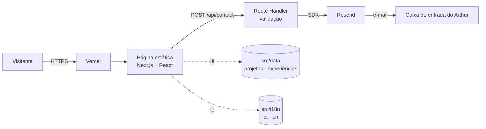
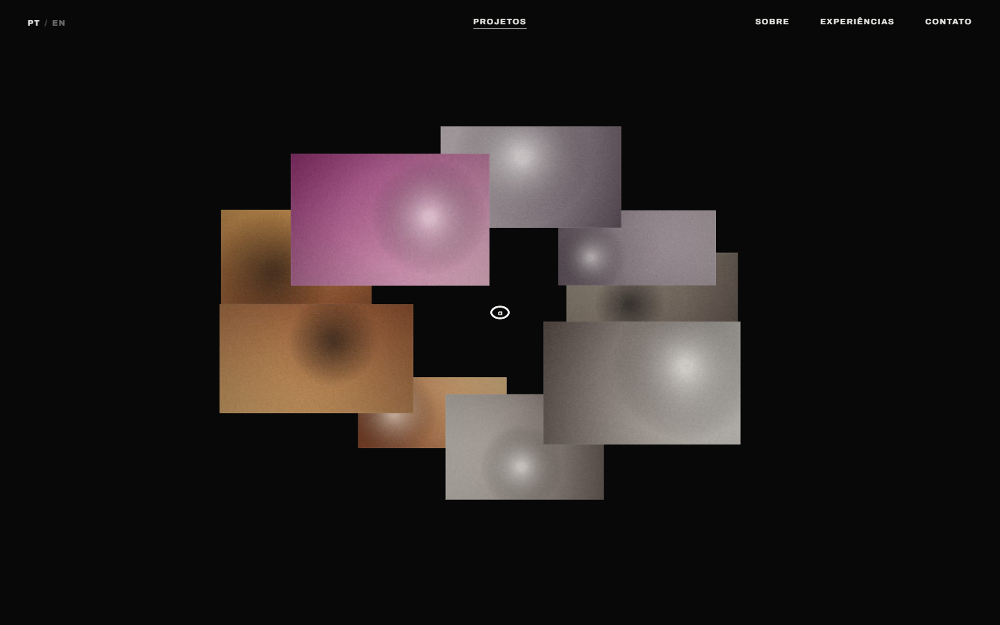
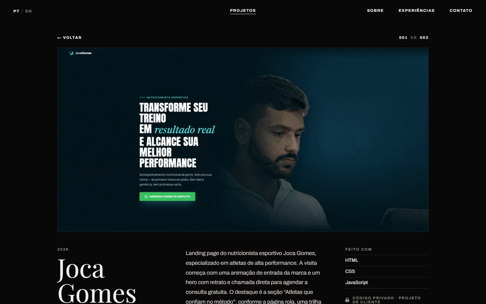
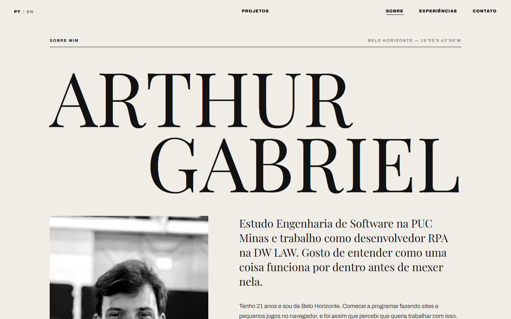
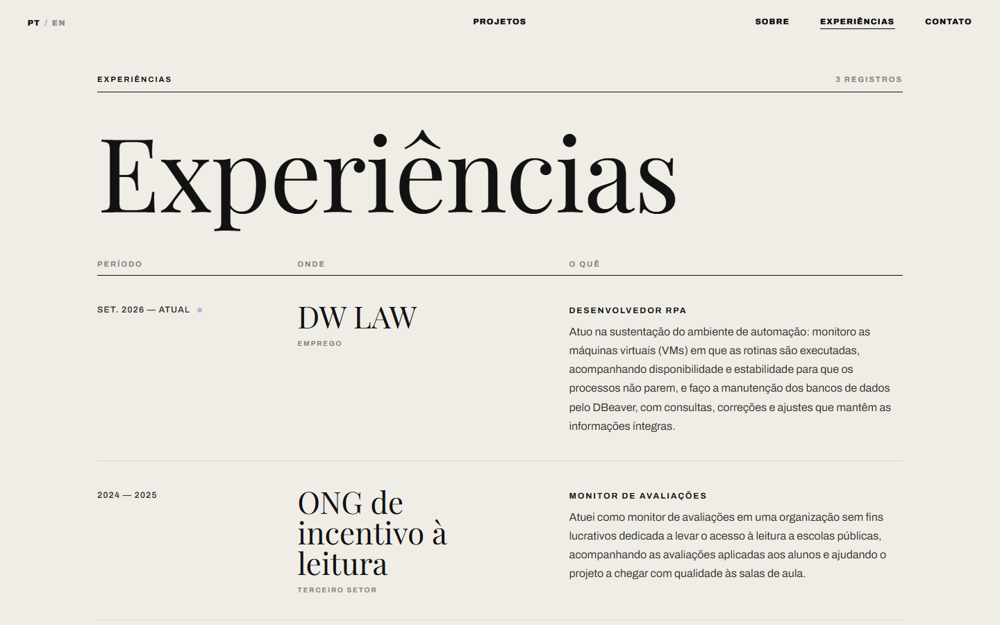
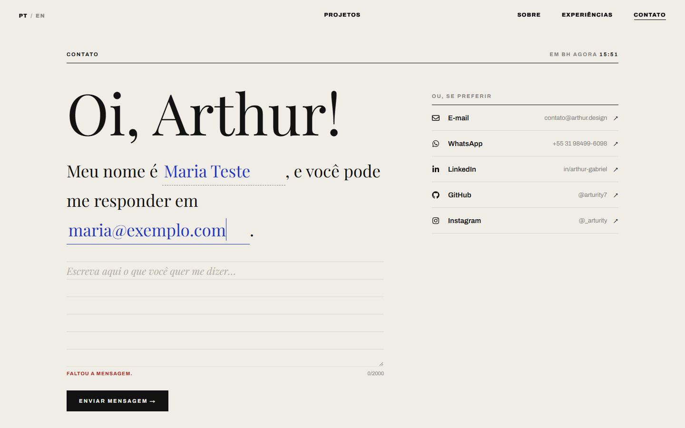
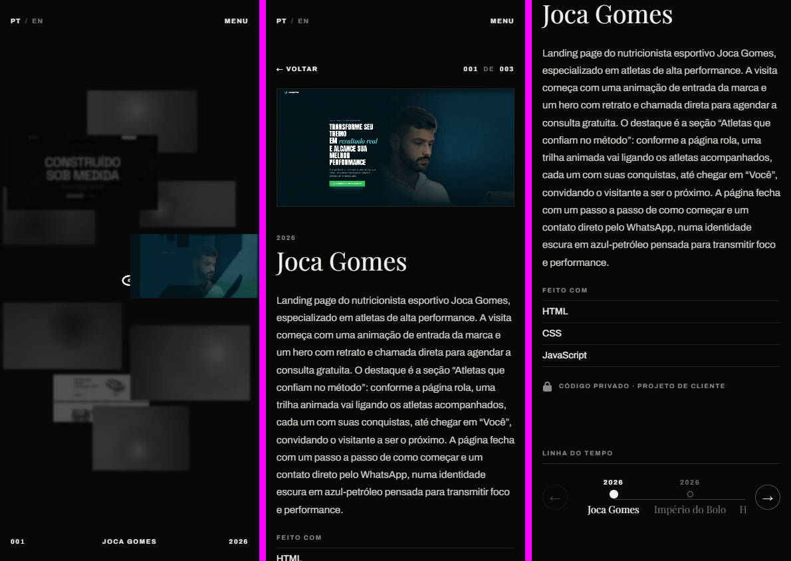

---

# 🏷️ Portfólio — Arthur Gabriel 👨‍💻

> [!NOTE]
> Portfólio profissional bilíngue (português/inglês) com os projetos girando num anel no centro da tela. Cada projeto abre com a demonstração do site rodando, descrição, tecnologias, link do repositório e uma navegação entre todos os projetos.

<table>
  <tr>
    <td width="800px">
      <div align="justify">
        Este repositório contém o <b>portfólio profissional</b> de Arthur Gabriel, desenvolvido no <i>Laboratório 01</i> da disciplina <b>Desenvolvimento e Integração de Aplicações Web (DIAW)</b> do curso de Engenharia de Software da <b>PUC Minas</b>. O site reúne <i>Sobre mim</i>, <i>Projetos</i>, <i>Experiências</i> e <i>Contato</i>, com troca de idioma sem recarregar a página, design responsivo e um formulário que envia e-mail por uma <b>rota de API própria</b> (back-end em Next.js) usando o <b>Resend</b>.
      </div>
    </td>
    <td>
      <div>
        
      </div>
    </td>
  </tr>
</table>

---

## 🚧 Status do Projeto

       

---

## 📚 Índice
- [Links Úteis](#-links-úteis)
- [Sobre o Projeto](#-sobre-o-projeto)
- [Funcionalidades Principais](#-funcionalidades-principais)
- [Tecnologias Utilizadas](#-tecnologias-utilizadas)
- [Arquitetura](#-arquitetura)
- [Instalação e Execução](#-instalação-e-execução)
  - [Pré-requisitos](#pré-requisitos)
  - [Variáveis de Ambiente](#-variáveis-de-ambiente)
  - [Instalação de Dependências](#-instalação-de-dependências)
  - [Como Executar a Aplicação](#-como-executar-a-aplicação)
- [Deploy](#-deploy)
- [Estrutura de Pastas](#-estrutura-de-pastas)
- [Como adicionar projetos e experiências](#-como-adicionar-projetos-e-experiências)
- [Demonstração](#-demonstração)
- [Testes](#-testes)
- [Documentações utilizadas](#-documentações-utilizadas)
- [Autores](#-autores)
- [Agradecimentos](#-agradecimentos)
- [Licença](#-licença)

---

## 🔗 Links Úteis
* 🌐 **Demo Online:** [arthur-portifolio-taupe.vercel.app](https://arthur-portifolio-taupe.vercel.app)
  > 💻 **Descrição:** site publicado na Vercel (build de produção do Next.js).

---

## 📝 Sobre o Projeto

O objetivo é apresentar minha trajetória, habilidades, projetos e formas de contato de um jeito que tenha a minha cara, sem cair no modelo genérico de portfólio. A ideia central, que existe desde a primeira versão deste site, é ter **algo rodando no meio da tela**: os projetos ficam num anel que gira devagar; ao passar o mouse, o escolhido cresce e os outros perdem cor.

- **Por que existe:** atividade avaliativa (Lab01, DIAW — PUC Minas) e, ao mesmo tempo, meu cartão de visita profissional.
- **Problema que resolve:** reunir num só lugar quem eu sou, o que já fiz e como falar comigo, em português e inglês.
- **Contexto:** acadêmico e profissional.
- **Onde pode ser utilizado:** currículo online, processos seletivos, LinkedIn e GitHub.

> [!NOTE]
> A primeira versão era um único `index.html` em HTML/CSS/JS puro. Nesta versão o projeto foi migrado para **Next.js + TypeScript**, ganhou back-end próprio para o envio de e-mail e passou a seguir os requisitos do laboratório.

---

## ✨ Funcionalidades Principais

- 🌀 **Anel de projetos:** os projetos giram no centro da tela, parados; no hover, o projeto em foco cresce, mostra índice, nome e ano e **começa a reproduzir sua demonstração**, enquanto os outros perdem cor. No celular, o 1º toque seleciona (e reproduz) e o 2º abre.
- 🎞️ **Projeto aberto:** demonstração do projeto em funcionamento (em loop), descrição, tecnologias e link para o repositório no GitHub — ou o aviso de repositório privado, no caso de projetos de clientes.
- 🏢 **Logos nas experiências:** cada empresa/instituição aparece com sua logo ao lado do nome.
- 🧭 **Navegação entre projetos:** dentro do projeto aberto, todos os projetos aparecem numerados, com navegação por clique, botões ou setas do teclado.
- 👤 **Sobre mim:** apresentação com formação, área de atuação, interesses e objetivos.
- 💼 **Experiências:** registro em colunas com período, empresa/instituição, cargo e descrição; item atual marcado.
- ✉️ **Contato:** ícones clicáveis (e-mail, WhatsApp, LinkedIn, GitHub, Instagram) e formulário em forma de carta que **envia e-mail** pela rota `POST /api/contact`.
- ✅ **Validação:** as mesmas regras rodam no navegador (feedback imediato) e no servidor (fonte da verdade), com campo-armadilha contra robôs.
- 🌐 **Internacionalização (i18n):** português e inglês, trocados **sem recarregar a página**; a escolha fica salva no navegador.
- 📱 **Responsivo:** layout próprio para celular, com menu em tela cheia.
- 🎬 **Transições:** loader de pontos, colapso das páginas numa máscara pixelada e revelação em meio-tom.
- ♿ **Acessibilidade:** navegação por teclado, `aria-*` nos estados, respeito a `prefers-reduced-motion`.

---

## 🛠 Tecnologias Utilizadas

### 💻 Front-end

* **Framework/Biblioteca:** Next.js 16 (App Router) + React 19
* **Linguagem/Superset:** TypeScript 5
* **Estilização:** CSS puro, dividido por seção em `src/styles/` (sem framework)
* **Gerenciamento de Estado:** estado local do React + Context API (idioma)
* **Ícones:** React Icons
* **Fontes:** Archivo, Playfair Display e Poppins via `next/font`
* **Build Tool:** Turbopack (padrão do Next.js 16)

### 🖥️ Back-end

* **Linguagem/Runtime:** Node.js 20+ (Route Handlers do Next.js)
* **Framework:** Next.js API Routes (`src/app/api/contact/route.ts`)
* **Envio de e-mail:** Resend (SDK oficial)
* **Banco de Dados:** não se aplica (conteúdo versionado em `src/data/`)

### ⚙️ Infraestrutura & DevOps

* **Cloud:** Vercel (deploy contínuo a partir da branch `main`)
* **Versionamento:** Git + GitHub

### 📦 Dependências

| Pacote | Versão | Uso |
| :--- | :--- | :--- |
| `next` | 16.3.8 | Framework (front + rotas de API) |
| `react` / `react-dom` | 19.3.0 | Interface |
| `resend` | 6.32.1 | Envio do e-mail de contato |
| `react-icons` | 5.7.0 | Ícones dos canais de contato e do GitHub |
| `typescript` *(dev)* | 5.9.3 | Tipagem |
| `@types/react`, `@types/react-dom`, `@types/node` *(dev)* | — | Tipos |

---

## 🏗 Arquitetura

Aplicação **monolítica em Next.js**: a mesma base serve a página (pré-renderizada como estática) e a rota de API do contato (função serverless na Vercel).

- **`Portfolio`** é o orquestrador: guarda a vista atual (projetos, sobre, experiências, contato) e controla as transições. Os estados visuais são classes no elemento raiz (`collapsed`, `stage-hidden`, `project-open`, `view-<página>`…), e o CSS reage a elas.
- **`Works`** desenha o anel. O movimento roda num `requestAnimationFrame` que escreve direto no DOM, sem re-renderizar o React a cada quadro.
- **`ProjectView`** mostra o projeto aberto e a navegação entre projetos.
- **Páginas** (`AboutPage`, `ExperiencePage`, `ContactPage`) leem os textos do dicionário de idiomas e os dados de `src/data/`.
- **`LanguageProvider`** (Context API) guarda o idioma e entrega o dicionário certo; trocar o idioma só re-renderiza o texto.
- **`/api/contact`** valida o corpo com as mesmas regras do front (`src/lib/contact.ts`) e envia o e-mail pelo Resend, com `replyTo` apontando para quem escreveu.



**Decisões e trade-offs**
- Conteúdo em arquivos TypeScript em vez de banco: é pouco, muda raramente e fica versionado junto com o código.
- CSS puro em vez de framework: as animações e o visual são muito específicos; utilitários atrapalhariam mais do que ajudariam.
- Validação compartilhada: uma única função evita que front e back discordem sobre o que é válido.

---

## 🔧 Instalação e Execução

### Pré-requisitos

* **Node.js:** v20.9 ou superior
* **Gerenciador de Pacotes:** npm
* **Conta no Resend** (gratuita) para o formulário de contato funcionar

---

### 🔑 Variáveis de Ambiente

Copie `.env.example` para `.env.local` na raiz do projeto e preencha:

| Variável | Descrição | Exemplo |
| :--- | :--- | :--- |
| `RESEND_API_KEY` | Chave da API do Resend | `re_xxxxxxxx` |
| `CONTACT_TO_EMAIL` | E-mail que recebe as mensagens do formulário | `gabrielarthur730@gmail.com` |
| `CONTACT_FROM_EMAIL` | *(opcional)* Remetente. Sem domínio verificado, use o padrão do Resend | `Portfólio <onboarding@resend.dev>` |

> [!IMPORTANT]
> Usando o remetente padrão `onboarding@resend.dev`, o Resend só entrega para o e-mail da própria conta. Por isso `CONTACT_TO_EMAIL` deve ser o e-mail com que você criou a conta no Resend (ou verifique um domínio próprio).

Sem essas variáveis o site funciona normalmente; só o formulário responde que o envio está indisponível e sugere os outros canais.

Na Vercel, cadastre as mesmas variáveis em **Project Settings → Environment Variables**.

---

### 📦 Instalação de Dependências

```bash
git clone https://github.com/arturity7/arthur-portifolio.git
cd arthur-portifolio
npm install
```

---

### ⚡ Como Executar a Aplicação

```bash
# desenvolvimento (recarrega ao salvar)
npm run dev
```
🎨 *Disponível em **http://localhost:3000**.*

```bash
# produção local
npm run build
npm start
```

```bash
# checagem de tipos
npm run lint
```

---

## 🚀 Deploy

1. Importe o repositório na **Vercel** (o `vercel.json` já define o framework como Next.js).
2. Cadastre as variáveis de ambiente da seção acima.
3. Cada `push` na `main` gera um novo deploy de produção; outras branches geram *Preview Deployments*.

---

## 📂 Estrutura de Pastas

```
.
├── .env.example               # 🧩 Variáveis necessárias (sem valores reais)
├── .gitignore                 # 🧹 Arquivos não versionados
├── README.md                  # 📘 Este documento
├── next.config.ts             # ⚙️ Configuração do Next.js
├── package.json               # 📦 Dependências e scripts
├── tsconfig.json              # 🔧 Configuração do TypeScript
├── vercel.json                # ☁️ Configuração do deploy
│
├── /docs
│   └── /screens               # 🖼️ Capturas de tela usadas neste README
│
├── /public
│   ├── /img                   # 🖼️ Foto do "Sobre mim"
│   ├── /img/logos             # 🏢 Logos das experiências
│   └── /projects/<slug>       # 🎞️ Demonstração de cada projeto (poster.jpg, ring.mp4, demo.mp4)
│
└── /src
    ├── /app
    │   ├── layout.tsx         # 🧱 HTML base, fontes, estilos globais e provedor de idioma
    │   ├── page.tsx           # 📄 Página única
    │   ├── icon.svg           # 🔖 Favicon
    │   └── /api/contact
    │       └── route.ts       # ✉️ Back-end: valida e envia o e-mail (Resend)
    ├── /components
    │   ├── Portfolio.tsx      # 🎛️ Orquestra vistas, navegação e transições
    │   ├── Header.tsx         # 🧭 Navegação, idioma e menu do celular
    │   ├── Loader.tsx         # ⏳ Tela de entrada
    │   ├── Works.tsx          # 🌀 Anel de projetos + HUD
    │   ├── ProjectView.tsx    # 🎞️ Projeto aberto + navegação entre projetos
    │   ├── AboutPage.tsx      # 👤 Sobre mim
    │   ├── ExperiencePage.tsx # 💼 Experiências
    │   ├── ContactPage.tsx    # ✉️ Contato (carta + canais)
    │   ├── PageFoot.tsx       # 🦶 Rodapé das páginas
    │   └── Mark.tsx           # ⭕ Marca "a" animada
    ├── /data
    │   ├── projects.ts        # 📁 Projetos (a ordem da lista é a ordem do site)
    │   ├── experiences.ts     # 📁 Experiências
    │   └── profile.ts         # 📇 Links de contato
    ├── /i18n
    │   ├── dictionary.ts      # 🌎 Textos em português e inglês
    │   └── LanguageProvider.tsx # 🔁 Contexto de idioma
    ├── /lib
    │   ├── contact.ts         # ✅ Validação compartilhada (front + back)
    │   └── visual.ts          # 🎨 Ruído, máscara pixelada, miniaturas
    └── /styles                # 🎨 CSS por seção (base, header, works, project, pages…)
```

---

## ➕ Como adicionar projetos e experiências

**Projeto:** grave um GIF do projeto rodando e converta-o com o [ffmpeg](https://ffmpeg.org/). Um GIF não pode ser pausado pelo navegador e pesa muito (os três primeiros somavam ~49 MB); convertido, vira um quadro parado para o anel e dois vídeos leves (~6 MB no total):

```bash
mkdir -p public/projects/meu-projeto
# quadro parado mostrado no anel (escolha o segundo com -ss)
ffmpeg -ss 2 -i meu-projeto.gif -frames:v 1 -vf "scale=960:-2" -q:v 3 public/projects/meu-projeto/poster.jpg
# vídeo leve que toca no anel durante o hover
ffmpeg -i meu-projeto.gif -movflags +faststart -pix_fmt yuv420p -c:v libx264 -crf 27 -vf "scale=640:-2" -an public/projects/meu-projeto/ring.mp4
# vídeo da página do projeto
ffmpeg -i meu-projeto.gif -movflags +faststart -pix_fmt yuv420p -c:v libx264 -crf 24 -vf "scale=1280:-2" -an public/projects/meu-projeto/demo.mp4
```

Depois adicione um item em `src/data/projects.ts`:

```ts
{
  slug: "meu-projeto",
  title: "Meu Projeto",
  description: { pt: "…", en: "…" },
  stack: ["Java", "Spring Boot"],
  repo: "https://github.com/arturity7/meu-projeto", // ou null se o repositório for privado
  media: mediaOf("meu-projeto"),
}
```

**Experiência:** coloque a logo (quadrada) em `public/img/logos/` e adicione um item em `src/data/experiences.ts` com `logo: "/img/logos/arquivo.png"` (`end: null` marca como atual).

---

## 🎥 Demonstração

### 🌐 Aplicação Web

| Tela | Captura de Tela |
| :---: | :---: |
| **Projetos (anel)** | **Projeto aberto** |
|  |  |
| **Sobre mim** | **Experiências** |
|  |  |
| **Contato** | **Celular** |
|  |  |

### 💻 API de contato (cURL)

```bash
curl -X POST http://localhost:3000/api/contact \
     -H 'Content-Type: application/json' \
     -d '{"name":"Maria","email":"maria@exemplo.com","message":"Olá, Arthur! Vi seu portfólio."}'
```

| Situação | Status | Resposta |
| :--- | :---: | :--- |
| Enviado | `200` | `{"ok":true}` |
| Campos inválidos | `422` | `{"error":"invalid","errors":{"email":"invalid"}}` |
| JSON malformado | `400` | `{"error":"bad_request"}` |
| Variáveis não configuradas | `503` | `{"error":"not_configured"}` |
| Falha no Resend | `502` | `{"error":"send_failed"}` |

---

## 🧪 Testes

Checagem de tipos:

```bash
npm run lint
```

Os fluxos (anel, abertura de projeto, navegação entre projetos, troca de idioma, validação e envio do formulário, versão mobile) foram verificados manualmente em navegador, em desktop (1440×900) e celular (390×844).

---

## 🔗 Documentações utilizadas

* 📖 **Framework:** [Documentação do **Next.js**](https://nextjs.org/docs)
* 📖 **Biblioteca:** [Documentação do **React**](https://react.dev/reference/react)
* 📖 **E-mail:** [Documentação do **Resend** (Node.js)](https://resend.com/docs/send-with-nodejs)
* 📖 **Deploy:** [Next.js na **Vercel**](https://vercel.com/docs/frameworks/nextjs)
* 📖 **Ícones:** [**React Icons**](https://react-icons.github.io/react-icons/)
* 📖 **Guia de Estilo:** [**Conventional Commits**](https://www.conventionalcommits.org/en/v1.0.0/)

---

## 👥 Autores

| 👤 Nome | :octocat: GitHub | 💼 LinkedIn | 📤 Gmail |
|---------|-----------------|-------------|-----------|
| Arthur Gabriel | <div align="center"><a href="https://github.com/arturity7"></a></div> | <div align="center"><a href="https://www.linkedin.com/in/arthur-gabriel-45316128b/"></a></div> | <div align="center"><a href="mailto:gabrielarthur730@gmail.com"></a></div> |

---

## 🙏 Agradecimentos

* [**Engenharia de Software PUC Minas**](https://www.instagram.com/engsoftwarepucminas/) — pela estrutura acadêmica.
* [**Prof. Dr. João Paulo Aramuni**](https://github.com/joaopauloaramuni) — pela proposta do laboratório e pelo template deste README.

---

## 📄 Licença

Este projeto é distribuído sob a **[Licença MIT](./LICENSE)**.

---
